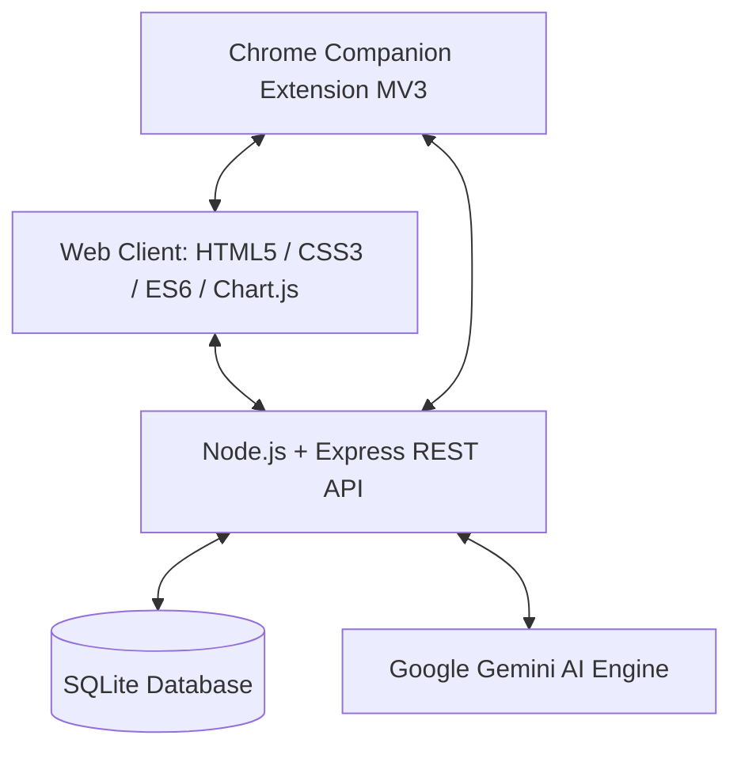

<div align="center">

# 🎓 StudySync — AI Smart Study Planner & Academic Mastery Ecosystem

[](https://nodejs.org/)
[](https://expressjs.com/)
[](https://www.sqlite.org/)
[](https://ai.google.dev/)
[](https://developer.chrome.com/docs/extensions/)
[](#license)

**An elite, modern, full-stack academic productivity workstation designed to eliminate exam anxiety, automate dynamic scheduling with Google Gemini AI, enforce deep focus, and track digital screen-time telemetry.**

[Features](#-key-features) • [Architecture](#-architecture--tech-stack) • [Quick Start](#-quick-start) • [Companion Extension](#-chrome-companion-extension) • [Configuration](#-environment-variables) • [License](#-license)

---

</div>

## 🌟 Key Features

### 🧠 1. AI Syllabus Decomposition & Dynamic Rebalancing
- **PDF & Text Syllabus Parsing**: Upload course syllabi or past exam papers; Google Gemini extracts chapters, assigns cognitive difficulty ratings (1–5), and calculates optimal completion timelines.
- **Dynamic Auto-Rescheduling**: If you fall behind or miss study tasks, one-click AI rebalancing recalculates your remaining workload without guilt or chaos.
- **AI Academic Chatbot**: Conversational study mentor powered by resilient Gemini model cascading (`gemini-2.5-flash`, `gemini-1.5-flash`, etc.).

### 🎧 2. Distraction-Free Audio Focus Room
- **Pomodoro & Deep Work Clock**: Customizable work/break intervals (25/5 Pomodoro, 50/10 Deep Work).
- **Web Audio Spatial Soundscapes**: Synthesized background audio generated directly via the Web Audio API — Rain, 40Hz Gamma Waves, Binaural Alpha Beats, and Lo-Fi Ambient White Noise.
- **Full-Screen Immersion**: Distraction-free full-screen mode with live audio visualizer equalizer bars.

### 🌐 3. Chrome Companion Extension (Focus Shield & Telemetry)
- **Hard Tab Lock**: Intercepts unauthorized tab switches during active focus sessions and immediately returns you to StudySync.
- **Automated Screen-Time Telemetry**: Automatically categorizes domain visits into *Study*, *Social Media*, *Entertainment*, and *Gaming*.
- **Manifest V3 Resilient Engine**: Background tracking persists across service worker wake/sleep cycles with local caching and periodic batch telemetry sync.

### 🔥 4. Habit Gamification & XP System
- **Daily Streak Engine**: Automatically tracks study consistency with grace-period logic and streak freeze safeguards.
- **XP & Level Progression**: Earn XP by checking off syllabus items, maintaining focus sessions, and staying within daily screen-time limits.
- **Visual Achievements**: Unlock milestone badges from *Novice Apprentice* to *Grandmaster Scholar*.

### 📱 5. Modern Glassmorphic UI & Mobile Polish
- **Dynamic Ambient Background**: Multi-layer sliding cybernetic perspective grid, morphing aurora light waves, and angled light beams.
- **Sleek Toast Notification System**: Custom glassmorphic toast notification engine with Lucide icons, slide transitions, and auto-dismiss progress bars.
- **Shimmer Skeleton Loading**: Animated skeleton states prevent layout shifts while data is fetched.
- **100% Smartphone Optimized**: Fully responsive layout tailored for mobile devices and tablets.

---

## 🏗️ Architecture & Tech Stack



| Layer | Technologies |
| :--- | :--- |
| **Frontend** | Vanilla JavaScript (ES6+), HTML5 Semantic Architecture, Modern CSS3 with CSS Custom Properties, Chart.js, Lucide Icons |
| **Backend** | Node.js, Express.js, Helmet, Express Rate Limit, Cookie-Parser, Multer |
| **Database** | SQLite3 with auto-initialization and automatic column migration |
| **Authentication** | JSON Web Tokens (JWT), Bcrypt password hashing |
| **AI Integration** | Google Generative AI (Gemini 2.5 Flash / Flash Preview) |
| **Browser Extension** | Chrome Manifest V3, Service Workers, Chrome Storage Local, Alarms API, Scripting API |

---

## 🚀 Quick Start

### Prerequisites
- [Node.js](https://nodejs.org/) (v18.0.0 or higher recommended)
- [npm](https://www.npmjs.com/) (bundled with Node.js)
- A Google Gemini API key (Free tier available at [Google AI Studio](https://aistudio.google.com/))

### 1. Clone the Repository
```bash
git clone https://github.com/your-username/studysync.git
cd studysync
```

### 2. Install Dependencies
```bash
npm install
```

### 3. Configure Environment Variables
Copy `.env.example` to `.env`:
```bash
cp .env.example .env
```
Open `.env` and fill in your configuration:
```env
PORT=5000
JWT_SECRET=your_super_secret_jwt_key
NODE_ENV=development
GEMINI_API_KEY=your_gemini_api_key_here
```

### 4. Start the Application
```bash
# Production start
npm start

# Development mode (with auto-reload)
npm run dev
```

Visit **`http://localhost:5000`** in your browser.

---

## 🧩 Chrome Companion Extension

The extension reinforces your focus sessions by blocking distracting domains and syncing live screen-time telemetry to your dashboard.

### Installation Instructions
1. Open Google Chrome, Brave, or Edge and navigate to `chrome://extensions`.
2. Enable **Developer mode** using the toggle in the top-right corner.
3. Click the **Load unpacked** button.
4. Select the `extension/` directory from this project.
5. The extension will automatically pair with your local StudySync dashboard at `http://localhost:5000`.

---

## 📁 Project Structure

```
StudySync/
├── extension/                  # Chrome Extension (Manifest V3)
│   ├── background.js           # Service worker (focus lock & telemetry sync)
│   ├── content.js              # In-page communication bridge
│   ├── manifest.json           # Manifest V3 extension configuration
│   ├── popup/                  # Extension toolbar popup interface
│   └── icons/                  # High-resolution extension icons
├── public/                     # Static web assets
│   ├── index.html              # Marketing & landing page
│   ├── dashboard.html          # Main student workstation
│   ├── auth.html               # Authentication portal (Login/Register)
│   ├── css/                    # Glassmorphic styles & responsive media queries
│   └── js/                     # Client modules (planner, focus, screentime, chat, toast)
├── server/                     # Backend API
│   ├── config/                 # Database initialization & configuration
│   ├── controllers/            # Route handlers (AI, auth, planner, screentime, tasks)
│   ├── middleware/             # Auth JWT verification & rate limiting
│   ├── routes/                 # Express API routes
│   └── index.js                # Server entrypoint
├── .env.example                # Sample environment configuration template
├── package.json                # Project dependencies and run scripts
└── README.md                   # Project documentation
```

---

## 🔐 Security & Privacy
- **Zero Third-Party Telemetry**: Screen-time tracking runs locally and is only transmitted directly to your self-hosted/local StudySync database.
- **Stateless Authentication**: Passwords hashed using `bcryptjs` with salted rounds; sessions secured via cryptographically signed JWTs.
- **Credential Protection**: Sensitive configuration files (`.env`, `*.db`) are strictly ignored from source control.

---

## 📄 License

This project is licensed under the [ISC License](LICENSE).
